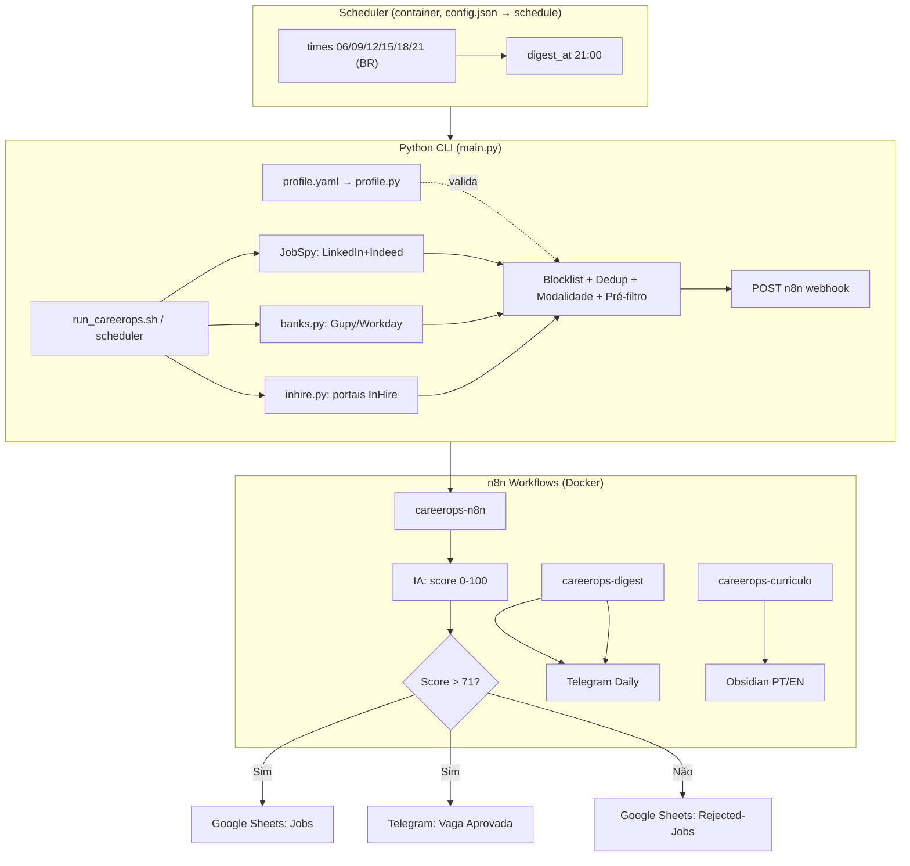

# CareerOps — Job Hunting Automation Pipeline

> **Pipeline automatizado de busca, filtragem, análise com IA e registro de vagas.**
> Configure seus critérios, rode localmente e receba as vagas aprovadas (Sheets + Telegram) e o resumo diário consolidado.

---

## 🎯 Para que serve

Automatiza a procura de emprego para perfis tech (SRE, DevOps, Cloud, Platform, Infra):
- **Busca** em LinkedIn + Indeed (JobSpy), **portais de bancos BR** (Gupy/Workday) e **portais InHire** (vagas diretas, com descoberta automática de empresas)
- **Filtra** localmente (blocklist, deduplicação normalizada, modalidade — aceita remoto/híbrido no BR, descarta presencial) e aplica um **pré-filtro determinístico por título** (corta funções fora do perfil antes da IA)
- **Perfil estruturado** (`profile.yaml`) como fonte única de verdade (níveis de experiência, objetivos, preferências); gera um `profile_context` e um **score determinístico** (`det_score`) enviados por vaga
- **Analisa** com IA (OpenAI/DeepSeek) comparando vaga vs seu currículo
- **Roteia** pelo score final `max(IA, det)` (via workflow `careerops-n8n`):
  - Score > 71 → **Google Sheets (aba `Jobs`) + Telegram** (notificação)
  - Score ≤ 71 → **Google Sheets (aba `Rejected-Jobs`)** (registrada, não descartada)
- **Resumo diário** (via workflow `careerops-digest`, separado): 1 mensagem Telegram consolidada
- **Agenda**: scheduler no container (`config.json → schedule`), resiliente a desligamento (catch-up)

---

## 🔄 Pipeline Flow

### Visão Geral (Mermaid)



### Diagrama Visual (Imagem)

📊 **[docs/careerops-flow.html](docs/careerops-flow.html)** — diagrama visual do fluxo (collector → IA → Sheets/Telegram). *Obs.: o HTML pode estar defasado em relação às fontes InHire e ao bloco de IA.*

### Fases do Pipeline

| Fase | Componente | Função |
|------|-----------|--------|
| **A: Coleta** | `main.py` + `jobspy.py` + `banks.py` + `inhire.py` | LinkedIn/Indeed (query OR, `results_per_source`) + bancos BR (Gupy/Workday) + portais InHire (de `data/inhire_companies.json`) |
| **B: Filtragem** | `main.py` + `filters.py` + `dedup.py` + `prefilter.py` | Blocklist (título/descrição/empresa), modalidade BR (remoto/híbrido sim, presencial não), dedup (URL + empresa/título/local) e **pré-filtro por título** (regras do perfil) |
| **C: Perfil & Score** | `profile.py` + `profile.yaml` + `scoring.py` | Carrega/valida o perfil, monta o `profile_context` e calcula o `det_score` determinístico — enviados no payload |
| **D: Envio** | `run_careerops.sh` | POST webhook n8n, rate-limit 2.5s, digest flag |
| **E: Orquestração** | n8n (`careerops-n8n`) | IA (DeepSeek/OpenAI) → `final = max(IA, det)` → Sheets (Jobs >71 / Rejected-Jobs ≤71) |
| **F: Digest** | n8n (`careerops-digest`) | Consolida dia → 1 msg Telegram (21h BR) |
| **G: Currículo** | n8n (`careerops-curriculo`) | Google Docs PT/EN → IA → Obsidian → Telegram |

---

## 🚀 Quick Start

```bash
# 1. Clone
git clone git@github.com:JPCastroBR/CareerOps.git
cd CareerOps

# 2. Configure credenciais (copie e edite)
cp .env.example .env
# Edite .env com seus tokens do Telegram (IA e Google configuram-se na UI do n8n)

# 3. Google Service Account
# Coloque o JSON em secrets/google-sa.json (não versionado)
# Ou cole em Configurações → Segredos → Service Account

# 4. Suba o stack — `make up` sobe E abre o dashboard no navegador
make up            # = docker compose up -d + xdg-open http://localhost:8080
# (ou só os containers:)
docker compose up -d

# 5. Teste uma busca
docker exec careerops-collector uv run python -m careerops.main --country Brazil --list

# 6. (Opcional) cron legado; o container scheduler já agenda sozinho
./scripts/install_cron_jobs.sh install
```

---

## ⚙️ Configuração Essencial

### 1. Variáveis de Ambiente (`.env`)

```bash
# Telegram — tokens injetados no n8n (digest + currículo)
TELEGRAM_BOT_TOKEN=123456:ABC...
TELEGRAM_CURRICULO_BOT_TOKEN=123456:ABC...
```

> **Nunca commite `.env`** — está no `.gitignore`. IA (OpenAI/DeepSeek) e Google Service Account são configurados na **UI do n8n** (não via `.env`).

### 2. Google Service Account

1. Crie Service Account no GCP
2. Dê permissão `Editor` no Sheets/Docs alvo
3. Salve JSON em `secrets/google-sa.json` (ou cole em **Configurações → Segredos**)
4. No n8n: Credentials → Google API → Service Account → cole o JSON

### 3. Seu Currículo (para IA comparar)

O n8n lê dois Google Docs (PT + EN). Configure os IDs no workflow `careerops-curriculo`:
- Doc PT: `1ABC...` (seu currículo em português)
- Doc EN: `1XYZ...` (versão English ATS)

---

## ⚙️ Configuração Externa (`config.json`)

**Todo o "extra" (países, modalidade, query de busca, blocklist de títulos) vive num arquivo `config.json` separado do código.** Assim ninguém precisa fuçar no `main.py` para personalizar.

### Como funciona
- Se `config.json` **existir** → o pipeline usa países, modalidades, query e blocklist definidos nele.
- Se `config.json` **não existir** → cai num fallback seguro: busca **`worldwide` (remoto-only)** apenas. Nunca quebra.
- O `config.json` é **versionado** como padrão do projeto; revise alvos pessoais antes de publicar. Para uso privado, mantenha o repo privado ou ajuste o arquivo localmente.

### Estrutura (`config.json`)
```json
{
  "search_query": "(SRE OR \"Site Reliability\" OR \"DevOps Engineer\" OR \"Platform Engineer\" OR \"Cloud Engineer\") AND (infrastructure OR cloud OR automation OR Terraform OR Kubernetes OR Docker) NOT (...)",
  "results_per_source": 500,
  "targets": [
    { "country": "Brazil", "work_mode": "any" }
  ],
  "work_modes": ["remote", "hybrid"],
  "prompt": "Você é um Tech Recruiter Sênior… (system prompt da IA)",
  "max_description_chars": 4000,
  "title_blocklist": ["junior", "intern", "manager", "qa", "suporte", "sales"],
  "company_blocklist": ["jobgether", "quik hire staffing", "lensa"],
  "banks": [
    { "name": "Itaú", "subdomain": "vemproitau", "source": "gupy" },
    { "name": "Santander", "subdomain": "santander.wd3.myworkdayjobs.com", "source": "workday", "workday": { "tenant": "santander", "site": "SantanderCareers" } }
  ],
  "bank_results_per_bank": 250,
  "bank_include_keywords": ["sre", "reliability", "devops", "platform", "infrastructure", "cloud"],
  "inhire": { "enabled": true, "companies_file": "data/inhire_companies.json", "results_per_company": 30 },
  "schedule": { "enabled": true, "timezone": "America/Sao_Paulo", "times": ["06:00","09:00","12:00","15:00","18:00","21:00"], "digest_at": "21:00", "misfire_grace_minutes": 30 }
}
```

### `work_mode` (modalidade de trabalho)
| Valor | Comportamento |
|-------|---------------|
| `remote` | Apenas vagas remotas (`is_remote=True`) |
| `onsite` | Apenas presenciais (`is_remote=False`) |
| `any` | Ambos (presencial + remoto) — gera 2 entradas por país |
| `hybrid` | Tratado como `any` (presencial + remoto) |

### `title_blocklist`
Lista de termos (case-insensitive) que descartam a vaga pelo **título**. Se vazia/ausente, usa a `BASE_TITLE_BLOCKLIST` interna (safety net). Para usar **sua** lista, preencha este array.

### `banks` (portais de carreira de bancos brasileiros)
Além de LinkedIn/Indeed (JobSpy), o pipeline varre portais próprios de bancos **BR** — fontes **Gupy** (`__NEXT_DATA__` do SSR) e **Workday** (API pública `cxs/jobs` + JSON-LD da página). Ideal para vagas SRE/DevOps/Cloud que os bancos só divulgam no portal interno, e para se candidatar **direto no site do banco** (link aponta pra lá).

```json
{
  "banks": [
    { "name": "Itaú",    "subdomain": "vemproitau", "source": "gupy" },
    { "name": "Sicredi", "subdomain": "sicredi",    "source": "gupy" },
    { "name": "BMG",     "subdomain": "bmg",        "source": "gupy" },
    { "name": "Santander", "subdomain": "santander.wd3.myworkdayjobs.com",
      "source": "workday",
      "workday": { "tenant": "santander", "site": "SantanderCareers" },
      "results": 25 }
  ],
  "bank_results_per_bank": 50,
  "bank_include_keywords": ["sre", "reliability", "devops", "platform", "infrastructure", "cloud", "nuvem", "kubernetes", "terraform", "aws", "azure", "gcp"]
}
```

| Chave | Obrigatória | Descrição |
|-------|-------------|-----------|
| `name` | sim | Rótulo exibido no pipeline (empresa no output) |
| `subdomain` | sim | Subdomínio do portal (`vemproitau` p/ Gupy; host `*.workdayjobs.com` p/ Workday) |
| `source` | não | `gupy` (padrão) ou `workday` |
| `workday.tenant` / `workday.site` | se `source=workday` | Tenant + código do site Workday (vêm da URL do portal) |
| `results` | não | Teto de detalhes por banco (sobrepõe `bank_results_per_bank`) |

- `bank_include_keywords`: pré-filtro de **título** aplicado ANTES de baixar a página de detalhe (economiza requests em portais com centenas de vagas).
- `bank_results_per_bank`: teto de detalhes buscados por banco (default `50`).
- Sem `source` configurado → usa `gupy`. Suporta **Gupy** (Itaú/Sicredi/BMG) e **Workday** (Santander) atualmente; Cornerstone/CSOD exige token anônimo — futura Fase.
- Rodam apenas em varredura **Brasil/global** e respeitam `work_modes` (remoto/híbrido).

> **Peculiaridade Workday**: a API `cxs/jobs` rejeita (`HTTP 400`) buscas com `limit ≥ 22`. O adapter usa `limit=20`, aplica um *rate gate* (≤8 req/60s, gap 2.5s) e pausa com backoff se o portal reclamar.

### `--source` (CLI)
| Valor | Comportamento |
|-------|---------------|
| `all` (padrão, via `config.scan_sources`) | JobSpy (LinkedIn/Indeed) **+** bancos BR (+ InHire se `inhire.enabled=true`) |
| `jobspy` | Só LinkedIn/Indeed |
| `banks` | Só portais de bancos BR (Gupy + Workday) |
| `inhire` | Só portais **InHire** (`data/inhire_companies.json` ou `inhire.companies`) |

```bash
docker exec careerops-collector uv run python -m careerops.main --source banks --list
docker exec careerops-collector uv run python -m careerops.main --source banks --dry-run   # sem n8n/memória/digest
docker exec careerops-collector uv run python -m careerops.main --source inhire --country Brazil --list
./scripts/run_careerops.sh banks                 # só bancos
./scripts/run_careerops.sh Brazil banks digest   # Brasil (JobSpy) + bancos
```

### Portais InHire (vagas diretas)

Coleta vagas direto dos portais `https://<slug>.inhire.app` via API pública (sem login): `GET https://api.inhire.app/job-posts/public/pages` com header `X-Tenant: <slug>` (detalhe em `/public/pages/{jobId}`).

- Lista de empresas em **`data/inhire_companies.json`** (`companies` + `disabled`); o dashboard permite habilitar/desabilitar por empresa e mostra o domínio `<slug>.inhire.app`.
- `inhire.enabled=true` inclui o InHire no `all` (ex.: `--country Brazil`); `false` deixa fora (rode com `--source inhire`).
- `inhire.include_keywords`: pré-filtro de título antes de baixar detalhes (vazio = lista focada em infra/cloud/observabilidade do adapter).

**Descobrir novas empresas** (crt.sh + Wayback, sem custo) e validar via API:
```bash
docker exec careerops-collector uv run python -m careerops.collector.inhire_discovery
./scripts/discover_inhire.sh          # wrapper; agende 1x/dia no cron
```

### Perfil Estruturado (`profile.yaml`)

Fonte única de verdade do candidato: objetivos/cargos-alvo, senioridade, experiências, competências com **nível** (`hands_on`, `working_knowledge`, `learning`, `conceptual`, `none`), `source` (`cv`/`user`/`project`) e `evidence`, além de idiomas, preferências de trabalho, `matching_guidance`, `title_matching` e `skill_aliases`.

- Carregado/validado por `src/careerops/profile.py`; usado pelo **pré-filtro**, pelo **contexto** enviado à IA (`build_profile_context`) e pelo **scorer** (`det_score`).
- Regra de integridade: nunca elevar `learning → working_knowledge → hands_on`; curso/certificação não implica experiência.

```bash
docker exec careerops-collector uv run python -c "from careerops.profile import load_profile; print(load_profile()['seniority']['target'])"
```

### Pré-filtro determinístico por título (Fase 9.1)

Antes de enviar à IA, descarta funções claramente fora do perfil com base em `profile.yaml → title_matching`:
- **hard** off-profile (ex.: Full Stack, Developer, Data/ML, QA, Product/Sales/Support, gestão, ERP/DBA) → descarta sempre;
- **soft** off-profile (Arquiteto, Segurança, Tech Lead) → descarta **salvo** se houver sinal de função-alvo;
- título **ambíguo/desconhecido** → **preservado** (não descarta).

O log por execução mostra `mantidas / descartadas / ambíguas` e o motivo de cada descarte (ex.: `off_profile_title:dev_software`).

### Scorer determinístico — `det_score` (Fase 9.3)

`src/careerops/scoring.py` calcula um score 0–100 orientado ao perfil (função + skills por nível + senioridade + modalidade; `learning` **não** reprova; hard blockers → 0). É enviado no payload (`det_score`/`det_rationale`). O n8n usa **`final = max(IA, det)`** — se a IA falhar ou vier vazia, o `det_score` garante que vagas-alvo não sejam descartadas.

### `--dry-run`
Coleta, filtra e mostra o que seria enviado **sem** tocar n8n, memória (`vagas_processadas.txt`) ou digest. Útil pra validar fontes novas.

### Exemplo prático
Quer só **Brasil remoto** + **Portugal remoto** + **worldwide remoto**?
```json
{
  "targets": [
    { "country": "Brazil", "work_mode": "remote" }
  ],
  "work_modes": ["remote"]
}
```
Pronto — sem tocar no código.

---

## 🌍 Personalizando Localidades (Países/Regiões)

### Opção A: Via CLI (execução única)
```bash
# Qualquer país suportado pelo JobSpy
docker exec careerops-collector uv run python -m careerops.main --country Brazil
docker exec careerops-collector uv run python -m careerops.main --country "United States"
docker exec careerops-collector uv run python -m careerops.main --country Germany --digest
```

**Aliases PT suportados**: `brasil`/`brazil`, `holanda`/`netherlands`, `alemanha`, `reino unido`/`uk`/`inglaterra`, `irlanda`, `polonia`/`polônia`, `suica`/`swiss`, `luxemburgo`, `dinamarca`, `noruega`, `suecia`/`suécia`, `austria`/`áustria`, `finlandia`/`finlândia`, `franca`/`frança`, `canada`, `mundo`/`global` (lista completa em `main.py → ALIASES`).

### Opção B: Agendamento Automático (container `scheduler`, sem cron)

Quem dispara é o container **`scheduler`** (`src/careerops/scheduler.py`), lendo `config.json → schedule`. **Não precisa criar cron.**

```json
"schedule": {
  "enabled": true,
  "timezone": "America/Sao_Paulo",
  "times": ["06:00", "11:00", "16:00", "21:00"],
  "digest_at": "21:00",
  "misfire_grace_minutes": 30
}
```

- `times`: horários das varreduras. `digest_at`: horário do resumo Telegram (pode coincidir com um `times`).
- `misfire_grace_minutes`: se o PC estava desligado, ainda roda um slot atrasado dentro dessa tolerância.
- Estado em `data/telemetry/scheduler_state.json` (não repete slot no mesmo dia).
- Editar pela aba **Agenda** do dashboard ou direto no JSON; `docker compose up -d` já sobe o scheduler.

> Cron do SO é opcional/legado: `scripts/install_cron_jobs.sh install` (lê a mesma agenda).

### Opção C: Modo Remoto vs Presencial

No **`config.json`** (não no código), cada `target` aceita `work_mode`:

| `work_mode` | Gera |
|------------|------|
| `remote` | 1 alvo remoto (`is_remote=True`) |
| `onsite` | 1 alvo presencial (`is_remote=False`) |
| `any` | 2 alvos (presencial + remoto) |
| `hybrid` | igual a `any` |

```json
"targets": [
  { "country": "Brazil", "work_mode": "remote" },
  { "country": "Germany", "work_mode": "onsite" },
  { "country": "Netherlands", "work_mode": "any" }
]
```

- **Brasil**: a modalidade é governada por `work_modes` — remoto e híbrido aceitos, presencial descartado.

---

## 💼 Personalizando Tipo de Vaga (Query de Busca)

### Query Principal (em `config.json`)

```json
"search_query": "\"Site Reliability Engineer\" OR \"SRE\" OR \"Infrastructure Engineer\" OR \"Cloud Infrastructure\" OR \"DevOps\""
```

**Para alterar**: edite `search_query` no seu `config.json` (não mexa no código).

**Exemplos de perfis:**

| Perfil | Query Sugerida |
|--------|----------------|
| **Backend/Go** | `"Golang" OR "Go Developer" OR "Backend Engineer" OR "API Developer"` |
| **Data Engineer** | `"Data Engineer" OR "Data Platform" OR "ETL" OR "Airflow" OR "dbt"` |
| **Kubernetes/Platform** | `"Platform Engineer" OR "Kubernetes" OR "K8s" OR "DevOps Platform"` |
| **Cloud Architect** | `"Cloud Architect" OR "Solutions Architect" OR "AWS Architect"` |
| **Full Stack** | `"Full Stack" OR "Fullstack" OR "React" AND "Node"` |

### Resultados por fonte (`results_per_source` em `config.json`)

```json
"results_per_source": 500
```

Sobrepõe os limites antigos por país/banco/empresa. `results_per_country` continua aceito como legado.

---

## 🎛 Ajustes por pessoa (`config.json`)

Tudo que muda de pessoa para pessoa está no `config.json` (o `profile.yaml` cobre currículo/skills):

| Chave | O que ajusta |
|-------|--------------|
| `search_query` | termos/cargos buscados |
| `hours_old` | janela de busca do JobSpy (24, 36, 48…) |
| `results_per_source` | vagas por fonte (por país/banco/empresa). Ex.: 500 — sobrepõe os limites antigos. |
| `results_per_country` | (legado) vagas por país no JobSpy |
| `bank_results_per_bank` | vagas por banco (Gupy/Workday) |
| `inhire.results_per_company` | vagas por empresa InHire |
| `targets` | países + `work_mode` |
| `title_blocklist` / `company_blocklist` | filtros de ruído |
| `work_modes` | modalidades habilitadas: `remote`, `hybrid`, `local` |
| `scan_sources` | fontes do comando de busca: `linkedin`, `indeed`, `gupy`, `workday`, `inhire` |
| `other_sources` | reservado — não é lido pelo código |
| `schedule` | horários (scheduler no container) |
| `profile.yaml` | currículo, skills por nível, cargos-alvo |
| `prompt` | system prompt da IA — editável no dashboard (seção **IA**) e enviado no payload |
| `max_description_chars` | corte da descrição antes da IA (economia de tokens) |

---

### Modalidades (`work_modes`)

Controla quais modalidades entram na busca e no resultado final:

```json
"work_modes": ["remote", "hybrid"]   // padrão: sem presencial/local
```

- `remote` → vagas remotas; `hybrid` → híbridas; `local` → presenciais.
- Vazio/ausente ou com as três → não filtra.
- Substitui o antigo `brazil_remote_only` (ainda aceito, mas ignorado quando `work_modes` existe).
- Vagas de modalidade **desconhecida** são preservadas (conservador).
- No dashboard, edite pela aba **Config → Guiado → Modalidades habilitadas**.

---

## 🛡 Personalizando Filtros (Blocklist)

### Títulos (`title_blocklist` no `config.json`)
```json
"title_blocklist": ["junior", "intern", "manager", "qa", "suporte", "sales", "frontend", "data scientist", "sap"]
```
Match por substring, case-insensitive, no campo título. Se vazio/ausente, usa a `BASE_TITLE_BLOCKLIST` interna.

### Descrições (barreiras: visto, idioma, clearance)
```python
# src/careerops/main.py → palavras_proibidas_descricao
palavras_proibidas_descricao = [
    "no visa sponsorship", "must have right to work",
    "fluent in german", "b2 deutsch", "c1 deutsch",
    "fluent in french", "courant français",
    "fluent in dutch", "vloeiend nederlands",
    "security clearance", "clearance",
    "werkstudent", "alternance", "internship",
]
```

### Empresas (aggregators / spam que não são empregadores reais) — via `config.json`
Bloqueia vagas de empresas listadas **antes** de enviar ao n8n/IA (economiza chamadas de IA com lixo). Match por substring, case-insensitive, no campo `company`.
```json
"company_blocklist": ["jobgether", "quik hire staffing", "lensa", "grabjobs", "jobrapido"]
```
*Default seguro em `main.py` já traz esse pequeno conjunto; `config.json` sobrescreve se presente.*

---

## 📈 Dashboard (ao vivo) + Agenda

Dashboard web leve (stdlib, sem deps extras) ao lado do n8n:

- **URL**: http://localhost:8080 — n8n continua em http://localhost:5678
- **Início**: página descritiva do projeto (por que existe + como funciona) com atalhos para dashboard, n8n e GitHub.
- **Mercado & Gaps**: compara o que as vagas pedem (`SKILLS_DA_VAGA`, normalizado via `skill_aliases`) com o seu `profile.yaml` — tabelas de **mais pedidas** (com situação domina/parcial/transferível/faltando) e **gaps prioritários**; botão **Priorização (IA)** envia a análise ao n8n (`careerops-gaps`) e devolve o que estudar. Nuvem é família transferível (AWS/OCI fortes → GCP/Azure/OCI não viram gap).
- **Navegação no topo**: logo · **Início / Visão geral / Vagas / Analisadas / Mercado** · link pro **n8n** · menu **Configurações** (Geral, Perfil, Agendamento, Workflows, Segredos)
- **Identidade visual**: redesign dark navy profissional, sistema de tokens, cards elevados, KPIs com ícones SVG, tipografia Inter e tabelas consistentes — sem libs novas (stdlib + vanilla JS/CSS).
- **Status de execução**: chip no header e painel **Status operacional** na Visão geral (status, execução, fonte, atualizado, início, erro); sem popup flutuante.
- **Visão geral**: 6 KPIs com percentuais reais, funil (pegas, compatíveis, rejeitadas, entrevistas), donut, faixas de score 70–80/80–90/90–100, plataformas, evolução temporal e vagas vistas com link, colunas **Enviada (n8n)**, **Enviado em**, **Analisada (IA)** e botão **Reenviar**.
- **Vagas/Analisadas**: títulos são links diretos para a vaga, com **paginação** (25/página) e botão **Reenviar** nas Analisadas; tabelas responsivas escondem colunas menos críticas no mobile.
- **Vaga manual por URL**: botão na aba Vagas abre um modal — cola o link de uma vaga, o dashboard extrai título/descrição e envia ao n8n (segue o fluxo normal até a planilha).
- **Rodapé**: assinatura **CareerOps · pipeline de busca de vagas** com link para o repositório oficial.
- **Analisadas**: tabela + CSV `data/telemetry/jobs_analyzed.csv` (data, empresa, título, local, fonte, score) com download.
- **Configuração**: seções numeradas — **1. Busca**, **2. Países e modalidades**, **3. Fontes**, **4. Filtros** — com **fontes por plataforma** (LinkedIn, Indeed, Gupy, Workday, InHire, Outros), **detecção por domínio** (inclui outras plataformas) e grupos por plataforma com **habilitar/desabilitar**, domínio, filtro e edição
- **Perfil**: **1. Objetivo**, **2. Experiência**, **3. Formação/Idiomas/Certificações**, **4. Experiência**, **5. Competências** (grupos hard/soft, skill com grupo+nível), **6. Apelidos de skills** (`skill_aliases`: ex. `kubernetes → k8s, eks, gke`), **7. Preferências de vaga** + Outros campos e prévia YAML
- **Planilha (Google Sheets)**: lê `Jobsearch-spy` (`Jobs`, `Rejected-Jobs`) via service account — cards, distribuição de score, **filtro por período (hoje/3/7/30 dias)**, busca, badges e colunas **Skills** e **OBS (IA)** (Salário removido: dado pessoal)
- **Agenda**: edita horários (`times` + `digest_at`) e mostra **próximos disparos**; o container `scheduler` executa sozinho (sem cron)

Arquivos de telemetria (runtime, gitignored): `data/telemetry/state.json`, `events.jsonl`, `jobs_analyzed.csv`.

```bash
docker compose up -d dashboard     # já sobe junto no `up -d`
```

Credenciais do Sheets (gitignored): `secrets/google-sa.json` (service account) e `secrets/sheets.json` (`spreadsheet_id` + abas). Overrides por env: `CAREEROPS_SHEET_ID`, `GOOGLE_SA_FILE`, `CAREEROPS_JOBS_TAB`.

> No modo Guiado do `profile.yaml`, o arquivo é reescrito (comentários YAML podem ser perdidos). Use **Avançado** para preservar o texto original.

**Segredos**: cofre de **credenciais** (nome, provedor, usuário, chave, observação) com **copiar chave/JSON**, editar e remover; **Service Account Google** (cole o JSON em `secrets/google-sa.json`), **Google Sheets** (ID/abas + testar) e **checklist de segurança**. Tudo em `secrets/` (gitignored, 600) e mascarado.

> **Reenvio**: o botão força o POST ao n8n. Payload completo fica em `data/telemetry/sent_jobs.jsonl`; vagas antigas sem payload são reenviadas mínimas (sem descrição).

> Sem autenticação: mantenha em localhost/LAN, não exponha na internet.

### Agenda — fonte única de horários

Os horários vivem em `config.json → schedule` (fonte única):

```json
"schedule": {
  "enabled": true,
  "timezone": "America/Sao_Paulo",
  "times": ["06:00", "09:00", "12:00", "15:00", "18:00", "21:00"],
  "digest_at": "21:00",
  "misfire_grace_minutes": 30
}
```

O container `scheduler` lê e dispara sozinho. O formato legado `jobs: [{time, digest}]` ainda é aceito. Cron do SO é opcional/legado: `scripts/install_cron_jobs.sh install` (`render`/`remove`/`list`).

---

## 🔁 Workflows do n8n (versionados)

Os fluxos do n8n ficam em **`n8n/workflows/*.json`** (um arquivo por workflow). Na UI: **Configurações → Workflows** (lista, prévia do JSON e botão **Importar para o n8n**).

```bash
./scripts/n8n_sync.sh export   # n8n -> projeto (após editar na UI)
./scripts/n8n_sync.sh import   # projeto -> n8n (aplica os JSONs)
./scripts/n8n_sync.sh list
```

- `import` **atualiza no lugar** (mesmo ID), sem duplicar, e **reativa** os workflows com `"active": true`. O botão usa o serviço **`n8n-sync`** (leva ~20s; breve downtime de webhook).
- **Padrão do repositório no primeiro deploy**: se o banco do n8n estiver **vazio**, o `n8n-sync` importa automaticamente os workflows de `n8n/workflows/` e os ativa. Se já existirem workflows, nada é sobrescrito; use **Importar** para aplicar o padrão do repo.
- **Credenciais não são exportadas** (só IDs/nomes). Em outra máquina, recrie no n8n (ou use `export:credentials`).
- **Tokens do Telegram não ficam nos JSONs**: os nós usam `{{ $env.TELEGRAM_BOT_TOKEN }}` / `{{ $env.TELEGRAM_CURRICULO_BOT_TOKEN }}`. **Preencha essas variáveis no `.env` antes de importar** (o compose injeta no n8n). Se um token já apareceu em workflow/commit, **rotacione no BotFather**.
- Os JSONs contêm IDs de planilha/doc, prompts e IDs de credenciais — cuidado ao publicar em repo público.
- **Workflows**: `careerops-n8n` (vagas → IA → Sheets), `careerops-digest` (resumo diário), `careerops-curriculo` (currículo ATS) e `careerops-gaps` (análise de competências — recebe `{prompt}` e devolve a priorização via OpenAI gpt-4o-mini).

## 📊 Outputs: Onde as Vagas Vão

> O `Score` gravado é o **final** = `max(IA, det_score)`. A IA segue como avaliadora principal; o `det_score` (determinístico, orientado ao perfil) garante piso quando a IA subestima uma vaga-alvo ou retorna vazia.

### Google Sheets — aba `Jobs` (Score > 71)
Planilha: **"Jobsearch-spy"** (aba `Jobs`)
| Coluna | Exemplo |
|--------|---------|
| Data | 2026-08-08 |
| Empresa | Nubank |
| Título | Senior SRE |
| Score | 87 |
| Aplicar | Sim |
| Entrevista | aguardando |
| Remota | Sim |
| Local | São Paulo |
| Skills | AWS, Terraform, K8s |
| OBS (IA) | resumo da IA |

### Google Sheets — aba `Rejected-Jobs` (Score ≤ 71)
Mesma planilha `Jobsearch-spy`, aba separada. **Toda** vaga avaliada é registrada aqui (não descartada) — serve para auditoria, aprendizado de padrões e evolução do filtro.

### Telegram (Vagas Aprovadas + Digest)
- **Vaga aprovada** (score > 71): notificação individual com score + skills match/missing
- **Digest diário** (workflow `careerops-digest`, separado): 1 msg consolidada (configurado para 21h BR)

---

## 🔧 Estrutura do Projeto

```
CareerOps/
├── .env.example           # Template (só TELEGRAM_BOT_TOKEN + CURRICULO)
├── .gitignore
├── docker-compose.yml     # n8n + app + n8n-sync + dashboard + scheduler
├── pyproject.toml         # Deps Python (uv)
├── config.json            # VERSIONADO — países, query, blocklist, schedule
├── profile.yaml           # Perfil profissional estruturado (fonte única de verdade)
├── scripts/
│   ├── install_cron_jobs.sh  # Cron legado (delega p/ careerops.schedule)
│   ├── run_careerops.sh      # Wrapper exec manual (log por país/data)
│   ├── discover_inhire.sh    # Descobre/valida tenants InHire (crt.sh + Wayback)
│   ├── n8n_sync.sh           # export/import dos workflows n8n
│   └── run_digest.sh         # Disparo manual digest
├── n8n/
│   ├── workflows/*.json      # Workflows versionados (careerops-n8n/-digest/-curriculo/-gaps)
│   └── sync_loop.sh          # Loop do n8n-sync (auto-import banco vazio)
├── secrets/               # NÃO VERSIONAR (SA Google, Sheets, chaves)
├── data/
│   ├── inhire_companies.json  # Tenants InHire validados (164)
│   ├── inhire_seed.txt        # Slugs semente de empresas InHire
│   └── telemetry/             # NÃO VERSIONAR (state.json, events, CSV)
├── logs/                  # NÃO VERSIONAR
├── docs/
│   └── careerops-flow.html  # Diagrama visual do fluxo (abrir no navegador)
├── tests/                 # 124 testes unittest (versionado)
└── src/careerops/
    ├── main.py            # CLI entry (--country, --list, --source, --digest)
    ├── dashboard.py       # UI (stdlib http.server + vanilla JS/CSS)
    ├── telemetry.py       # state.json / events.jsonl / jobs_analyzed.csv
    ├── sheets.py          # Leitor Google Sheets (Jobs/Rejected-Jobs/Salario)
    ├── schedule.py        # Fonte única de horários (config → schedule)
    ├── scheduler.py       # Container scheduler (loop por horário)
    ├── profile.py         # Carregador/validador do profile.yaml
    └── collector/
        ├── jobspy.py          # Wrapper JobSpy
        ├── banks.py           # Portais de bancos BR (Gupy + Workday)
        ├── inhire.py          # Portais InHire (vagas diretas)
        ├── inhire_discovery.py# Descoberta de tenants (crt.sh + Wayback)
        ├── filters.py         # Filtro de localização/modalidade
        ├── dedup.py           # Deduplicação normalizada
        ├── prefilter.py       # Pré-filtro determinístico por título
        ├── scoring.py         # Scorer determinístico (det_score)
        └── parser.py          # Normalização payload
```

---

## 🐳 Docker Compose (Serviços)

```yaml
# docker-compose.yml — serviços
services:
  n8n:        # orquestração + IA (localhost:5678)
  app:        # coletor Python (container careerops-collector)
  n8n-sync:   # importa/reativa workflows de n8n/workflows/
  dashboard:  # UI de observabilidade/config (localhost:8080)
  scheduler:  # agenda do config.json → schedule
```

---

## 📅 Agendamento: Design Resiliente

| Problema | Solução |
|----------|---------|
| Computador desligado no horário | Wrapper idempotente → rode manualmente quando ligar |
| Execução duplicada | `vagas_processadas.txt` evita duplicatas |
| Múltiplos digests/dia | Flag `digest` apenas em 1 job/dia (último) |
| Rastreabilidade | Logs por dia: `logs/careerops-YYYYMMDD.log` |
| Quais países varrer | Vem do `config.json` (não do cron) — edite o JSON, não o agendador |

**Comandos de cron:**
```bash
./scripts/install_cron_jobs.sh install   # instala/atualiza
./scripts/install_cron_jobs.sh list      # mostra ativos
./scripts/install_cron_jobs.sh remove    # remove todos
./scripts/install_cron_jobs.sh test      # testa 1 execução (lê config.json)
```

---

## 🔐 Segurança (Obrigatório)

| Arquivo | No .gitignore? | Ação |
|---------|----------------|------|
| `.env` | ✅ | Nunca commite |
| `secrets/*.json` | ✅ | Nunca commite |
| `vagas_processadas.txt` | ✅ | Estado local |
| `logs/` | ✅ | Apenas local |
| `.venv/` | ✅ | Local only |
| `uv.lock` | ❌ | **Versionar** (reprodutibilidade) |
| `n8n/workflows/*.json` | ❌ | Versionar; **tokens só via `$env`** |

> ⚠️ **Rotação obrigatória**: versões antigas dos workflows tinham tokens do Telegram embutidos nas URLs. Eles foram trocados por `{{ $env.TELEGRAM_BOT_TOKEN }}` / `{{ $env.TELEGRAM_CURRICULO_BOT_TOKEN }}`. **Rotacione esses tokens no @BotFather**, preencha o `.env` e reinicie o n8n. Tokens que já apareceram em histórico/commit devem ser considerados comprometidos.

---

## 🛠 Desenvolvimento

```bash
# Instalar deps
uv sync

# Rodar testes (unittest; ver tests/)
uv run --project . python -m unittest discover -s tests

# Sobe o stack
docker compose up -d
```

---

## 📝 Checklist para Novo Usuário

- [ ] Clone repo
- [ ] Copie `.env.example` → `.env` e preencha chaves
- [ ] Crie Google Service Account → `secrets/google-sa.json` (ou use Configurações → Segredos)
- [ ] Configure n8n com credenciais Google + IA (DeepSeek/OpenAI) + Telegram
- [ ] Suba o stack: `docker compose up -d` (o `n8n-sync` importa os workflows padrão se o banco estiver vazio)
- [ ] Edite `config.json`: `search_query` + `targets` + `title_blocklist` (+ `inhire`)
- [ ] Edite `profile.yaml` ou use **Configurações → Perfil** (fonte de verdade)
- [ ] Ajuste horários em **Configurações → Agendamento** (fonte única: `config.json`)
- [ ] Teste: `docker exec careerops-collector uv run python -m careerops.main --country Brazil --list`
- [ ] Acesse o dashboard: http://localhost:8080

---

## 🤝 Contribuindo

1. Fork → branch `feature/xyz`
2. Adicione testes para novos filtros/fontes (`uv run --project . python -m unittest discover -s tests`)
3. `docker compose up -d` + valide no dashboard
4. PR com descrição do que muda e por quê

---

## 📄 Licença

MIT — Use, adapte, compartilhe.