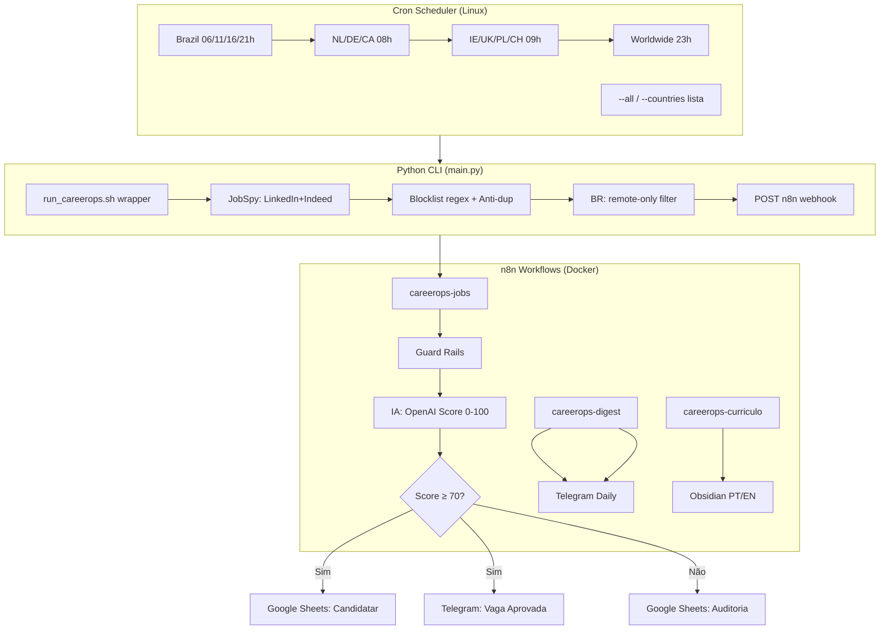

# CareerOps — Job Hunting Automation Pipeline

> **Pipeline automatizado de busca, filtragem, análise com IA e registro de vagas.**
> Configure seus critérios, rode localmente e receba as vagas aprovadas (Sheets + Telegram) e o resumo diário consolidado.

---

## 🎯 Para que serve

Automatiza a procura de emprego para perfis tech (SRE, DevOps, Cloud, Platform, Infra):
- **Busca** em LinkedIn + Indeed via JobSpy **+ portais de bancos brasileiros** (Gupy e Workday)
- **Filtra** localmente (blocklist, anti-duplicidade, modalidade)
- **Analisa** com IA (OpenAI/OpenRouter) comparando vaga vs seu currículo
- **Roteia por score** (via workflow `careerops-jobs`):
  - Score ≥ 70 → **Google Sheets (aba Candidatar) + Telegram** (notificação)
  - Score < 70 → **Google Sheets (aba Auditoria)** (registrada, não descartada)
- **Resumo diário** (via workflow `careerops-digest`, separado): 1 mensagem Telegram consolidada
- **Agenda**: Cron multi-país/horário, resiliente a desligamento (catch-up manual)

---

## 🔄 Pipeline Flow

### Visão Geral (Mermaid)



### Diagrama Visual (Imagem)

📊 **[docs/careerops-flow.html](docs/careerops-flow.html)** — abra no navegador para ver o fluxo completo colorido (collector → guard rails → IA → Sheets/Telegram).

### Fases do Pipeline

| Fase | Componente | Função |
|------|-----------|--------|
| **A: Coleta** | `main.py` + `jobspy.py` + `banks.py` + `inhire/` | Busca LinkedIn/Indeed (200 vagas/país, query OR) + portais de bancos BR (Gupy/Workday) + tenants InHire (API pública) |
| **B: Filtragem** | `filters.py` | Blocklist regex (título+descrição), anti-dup (`vagas_processadas.txt`), BR remoto-only |
| **C: Envio** | `run_careerops.sh` | POST webhook n8n, rate-limit 2.5s, digest flag |
| **D: Orquestração** | n8n (`careerops-jobs`) | Guard Rails → IA (OpenAI) → Score → Sheets (Candidatar ≥70 / Auditoria <70) + Telegram aprovadas |
| **E: Digest** | n8n (`careerops-digest`) | Consolida dia → 1 msg Telegram (21h BR) |
| **F: Currículo** | n8n (`careerops-curriculo`) | Google Docs PT/EN → IA → Obsidian → Telegram |

---

## 🚀 Quick Start

```bash
# 1. Clone
git clone git@github.com:SEU_USUARIO/CareerOps.git
cd CareerOps

# 2. Configure credenciais (copie e edite)
cp .env.example .env
# Edite .env com suas chaves: OPENAI_API_KEY, TELEGRAM_BOT_TOKEN, etc.

# 3. Google Service Account
# Coloque o JSON em credentials/google-sa.json (não versionado)

# 4. Suba o stack
docker compose up -d

# 5. Teste uma busca
docker exec careerops-collector uv run src/careerops/main.py --country Brazil --list

# 6. Instale agendamento automático (opcional)
./scripts/install_cron_jobs.sh install
```

---

## ⚙️ Configuração Essencial

### 1. Variáveis de Ambiente (`.env`)

```bash
# IA (OpenAI ou OpenRouter)
OPENAI_API_KEY=sk-...
# ou
OPENROUTER_API_KEY=sk-or-...

# Telegram (bot + chat onde recebe alertas/digest)
TELEGRAM_BOT_TOKEN=123456:ABC...
TELEGRAM_CHAT_ID=123456789

# n8n (para gestão remota de workflows)
N8N_API_KEY=eyJhbGciOi...
```

> **Nunca commite `.env`** — está no `.gitignore`.

### 2. Google Service Account

1. Crie Service Account no GCP
2. Dê permissão `Editor` no Sheets/Docs alvo
3. Salve JSON em `credentials/google-sa.json`
4. No n8n: Credentials → Google API → Service Account → cole o JSON

### 3. Seu Currículo (para IA comparar)

O n8n lê dois Google Docs (PT + EN). Configure os IDs no workflow `careerops-curriculo`:
- Doc PT: `1ABC...` (seu currículo em português)
- Doc EN: `1XYZ...` (versão English ATS)

---

## ⚙️ Configuração Externa (`config.json`)

**Todo o "extra" (países, modalidade, query de busca, blocklist de títulos) vive num arquivo `config.json` separado do código.** Assim ninguém precisa fuçar no `main.py` para personalizar.

### Como funciona
- Se `config.json` **existir** → o pipeline usa países, modalidades, query e blocklist definidos nele.
- Se `config.json` **não existir** → cai num fallback seguro: busca **`worldwide` (remoto-only)** apenas. Nunca quebra.
- O arquivo está no `.gitignore` (não sobe pro repo) — cada usuário mantém o seu.

### Estrutura (`config.json`)
```json
{
  "_comment": "All keys optional. English canonical country names.",
  "search_query": "\"Site Reliability Engineer\" OR \"SRE\" OR \"DevOps\"",
  "results_per_country": 200,
  "targets": [
    { "country": "Brazil", "work_mode": "remote" },
    { "country": "Netherlands", "work_mode": "any" },
    { "country": "Germany", "work_mode": "onsite" },
    { "country": "worldwide", "work_mode": "remote" }
  ],
  "title_blocklist": ["junior", "intern", "manager"],
  "company_blocklist": ["jobgether", "quik hire staffing", "lensa"],
  "brazil_remote_only": true,
  "banks": [
    { "name": "Itaú", "subdomain": "vemproitau", "source": "gupy" }
  ],
  "bank_results_per_bank": 50,
  "bank_include_keywords": ["sre", "devops", "cloud"]
}
```

### `work_mode` (modalidade de trabalho)
| Valor | Comportamento |
|-------|---------------|
| `remote` | Apenas vagas remotas (`is_remote=True`) |
| `onsite` | Apenas presenciais (`is_remote=False`) |
| `any` | Ambos (presencial + remoto) — gera 2 entradas por país |
| `hybrid` | Tratado como `any` (presencial + remoto) |

### `title_blocklist`
Lista de termos (case-insensitive) que descartam a vaga pelo **título**. Se vazia/ausente, usa a `BASE_TITLE_BLOCKLIST` interna (safety net). Para usar **sua** lista, preencha este array.

### `brazil_remote_only`
- `true` (padrão): descarta vagas do Brasil presenciais/híbridas (filtro extra por regex em location+título).
- `false`: mantém todas as modalidades do Brasil.

### `banks` (portais de carreira de bancos brasileiros)
Além de LinkedIn/Indeed (JobSpy), o pipeline varre portais próprios de bancos **BR** — fontes **Gupy** (`__NEXT_DATA__` do SSR) e **Workday** (API pública `cxs/jobs` + JSON-LD da página). Ideal para vagas SRE/DevOps/Cloud que os bancos só divulgam no portal interno, e para se candidatar **direto no site do banco** (link aponta pra lá).

```json
{
  "banks": [
    { "name": "Itaú",    "subdomain": "vemproitau", "source": "gupy" },
    { "name": "Sicredi", "subdomain": "sicredi",    "source": "gupy" },
    { "name": "BMG",     "subdomain": "bmg",        "source": "gupy" },
    { "name": "Santander", "subdomain": "santander.wd3.myworkdayjobs.com",
      "source": "workday",
      "workday": { "tenant": "santander", "site": "SantanderCareers" },
      "results": 25 }
  ],
  "bank_results_per_bank": 50,
  "bank_include_keywords": ["sre", "reliability", "devops", "platform", "infrastructure", "cloud", "nuvem", "kubernetes", "terraform", "aws", "azure", "gcp"]
}
```

| Chave | Obrigatória | Descrição |
|-------|-------------|-----------|
| `name` | sim | Rótulo exibido no pipeline (empresa no output) |
| `subdomain` | sim | Subdomínio do portal (`vemproitau` p/ Gupy; host `*.workdayjobs.com` p/ Workday) |
| `source` | não | `gupy` (padrão) ou `workday` |
| `workday.tenant` / `workday.site` | se `source=workday` | Tenant + código do site Workday (vêm da URL do portal) |
| `results` | não | Teto de detalhes por banco (sobrepõe `bank_results_per_bank`) |

- `bank_include_keywords`: pré-filtro de **título** aplicado ANTES de baixar a página de detalhe (economiza requests em portais com centenas de vagas).
- `bank_results_per_bank`: teto de detalhes buscados por banco (default `50`).
- Sem `source` configurado → usa `gupy`. Suporta **Gupy** (Itaú/Sicredi/BMG) e **Workday** (Santander) atualmente; Cornerstone/CSOD exige token anônimo — futura Fase.
- Rodam apenas em varredura **Brasil/global** e respeitam `brazil_remote_only` (só remoto).

> **Peculiaridade Workday**: a API `cxs/jobs` rejeita (`HTTP 400`) buscas com `limit ≥ 22`. O adapter usa `limit=20`, aplica um *rate gate* (≤8 req/60s, gap 2.5s) e pausa com backoff se o portal reclamar.

### `inhire` (tenants InHire — Fases 1-12)

Fonte nativa que varre **tenants** da InHire (`*.inhire.app`) — ATS usado por
várias empresas BR (Magalu, Ifood, Bradesco, Stone, XP, etc.). Sem base class,
sem DB: descobretenants (`seed` + Wayback CDX), valida via API pública
(`GET https://api.inhire.app/job-posts/public/pages` + header `X-Tenant`), coleta
vagas ativas, normaliza, ranqueia contra o CV (`cv_profile.CVProfile`) e
deduplica. Persistência em JSON/JSONL em `data/`.

```json
{
  "inhire": {
    "enabled": true,
    "api_base": "https://api.inhire.app",
    "seed_file": "data/inhire_seed.txt",
    "sources": ["seed", "wayback"],
    "include_keywords": ["sre", "devops", "platform", "cloud", "kubernetes", "aws"],
    "min_score": 60,
    "http": { "timeout": 10, "retries": 3, "backoff_base": 1.5, "delay": 0.4 }
  }
}
```

| Subcomando | Comportamento |
|------------|---------------|
| `inhire discover [--source seed\|wayback]` | Lista candidatos a tenant (sem validar) |
| `inhire validate [--limit N]` | Valida tenants (seed + repo) via API e persiste ativos |
| `inhire jobs [--tenant X] [--min-score N]` | Coleta vagas dos tenants ativos |
| `inhire run [--min-score N] [--force]` | Pipeline completo: discover→validate→collect→dedupe |

```bash
docker exec careerops-collector uv run src/careerops/main.py inhire discover --source seed
docker exec careerops-collector uv run src/careerops/main.py inhire validate
docker exec careerops-collector uv run src/careerops/main.py inhire run --min-score 0
```

- `min_score` (default `60`): threshold do matching local; `< 60` cai em `LOW` mas não é descartado aqui — só filtrado quando `> 0`.
- `data/inhire_seed.txt`: uma slug por linha (sem `.inhire.app`); comentários com `#`; slugs são sanitizados (minúsculo, sem acento).
- URL da vaga: `https://<tenant>.inhire.app/vagas/<jobId>/<slug-do-titulo>`.
- **Descrição**: o `jobsPage` não a traz; cada vaga é enriquecida via `GET /job-posts/public/pages/<jobId>` (header `X-Tenant`) antes do matching — evita que a IA do n8n alucine com título vazio.
- Matching local (7 dimensões): `role`, `skills`, `cloud`, `seniority`, `location`, `remote`, `experience`. Edite `cv_profile.py` quando o CV evoluir.

### `--source` (CLI)
| Valor | Comportamento |
|-------|---------------|
| `all` (padrão) | JobSpy (LinkedIn/Indeed) **+** bancos BR |
| `jobspy` | Só LinkedIn/Indeed (comportamento antigo) |
| `banks` | Só portais de bancos BR (Gupy + Workday) |
| `inhire` | Só tenants InHire (discover→validate→collect→dedupe) |

```bash
docker exec careerops-collector uv run src/careerops/main.py --source banks --list
docker exec careerops-collector uv run src/careerops/main.py --source banks --dry-run   # sem n8n/memória/digest
./scripts/run_careerops.sh banks                 # só bancos
./scripts/run_careerops.sh Brazil banks digest   # Brasil (JobSpy) + bancos
```

### `--dry-run`
Coleta, filtra e mostra o que seria enviado **sem** tocar n8n, memória (`vagas_processadas.txt`) ou digest. Útil pra validar fontes novas.

### Exemplo prático
Quer só **Brasil remoto** + **Portugal remoto** + **worldwide remoto**?
```json
{
  "targets": [
    { "country": "Brazil", "work_mode": "remote" },
    { "country": "Portugal", "work_mode": "remote" },
    { "country": "worldwide", "work_mode": "remote" }
  ],
  "brazil_remote_only": true
}
```
Pronto — sem tocar no código.

---

## 🌍 Personalizando Localidades (Países/Regiões)

### Opção A: Via CLI (execução única)
```bash
# Qualquer país suportado pelo JobSpy
docker exec careerops-collector uv run src/careerops/main.py --country Brazil
docker exec careerops-collector uv run src/careerops/main.py --country "United States"
docker exec careerops-collector uv run src/careerops/main.py --country Germany --digest
```

**Aliases PT suportados**: `brasil`, `holanda`, `alemanha`, `reino unido`/`uk`/`inglaterra`, `irlanda`, `polonia`, `suica`, `dinamarca`, `noruega`, `suecia`, `austria`, `finlandia`, `franca`, `canada`, `mundo`/`global`.

### Opção B: Agendamento Automático (sem países hardcoded)

O cron **não** decide países — ele só marca *quando* rodar. Os países vêm do `config.json`. Edite `scripts/install_cron_jobs.sh` → array `SCHEDULES` (apenas horários):

```bash
readonly SCHEDULES=(
    "0 6 * * *"          # varre config.json
    "0 11 * * *"
    "0 16 * * *"
    "0 21 * * * digest"  # última do dia dispara digest
    "0 8 * * *"
    "0 9 * * *"
    "0 23 * * *"
)
```

**Formato**: `"minuto hora dia mês semana [digest]"`
- `digest` = dispara resumo Telegram ao final (use em **apenas 1** job/dia)
- Sem país: o wrapper lê `config.json` e varre os `targets` definidos lá

Para mudar *quais* países/modalidades → edite `config.json`, não o cron. Depois reinstale:
```bash
./scripts/install_cron_jobs.sh install
```

### Opção C: Modo Remoto vs Presencial

No **`config.json`** (não no código), cada `target` aceita `work_mode`:

| `work_mode` | Gera |
|------------|------|
| `remote` | 1 alvo remoto (`is_remote=True`) |
| `onsite` | 1 alvo presencial (`is_remote=False`) |
| `any` | 2 alvos (presencial + remoto) |
| `hybrid` | igual a `any` |

```json
"targets": [
  { "country": "Brazil", "work_mode": "remote" },
  { "country": "Germany", "work_mode": "onsite" },
  { "country": "Netherlands", "work_mode": "any" }
]
```

- **Brasil**: além do `work_mode`, há o flag `brazil_remote_only: true` que descarta presencial/híbrido por regex (location + título).

---

## 💼 Personalizando Tipo de Vaga (Query de Busca)

### Query Principal (em `config.json`)

```json
"search_query": "\"Site Reliability Engineer\" OR \"SRE\" OR \"Infrastructure Engineer\" OR \"Cloud Infrastructure\" OR \"DevOps\""
```

**Para alterar**: edite `search_query` no seu `config.json` (não mexa no código).

**Exemplos de perfis:**

| Perfil | Query Sugerida |
|--------|----------------|
| **Backend/Go** | `"Golang" OR "Go Developer" OR "Backend Engineer" OR "API Developer"` |
| **Data Engineer** | `"Data Engineer" OR "Data Platform" OR "ETL" OR "Airflow" OR "dbt"` |
| **Kubernetes/Platform** | `"Platform Engineer" OR "Kubernetes" OR "K8s" OR "DevOps Platform"` |
| **Cloud Architect** | `"Cloud Architect" OR "Solutions Architect" OR "AWS Architect"` |
| **Full Stack** | `"Full Stack" OR "Fullstack" OR "React" AND "Node"` |

### Resultados por País (parâmetro `results_per_country` em `config.json`)

```json
"results_per_country": 200
```

---

## 🛡 Personalizando Filtros (Blocklist)

### Títulos (remove cargos fora do escopo)
```python
# src/careerops/main.py → palavras_proibidas_titulo
palavras_proibidas_titulo = [
    "estágio", "junior", "jr", "pleno", "mid-level",
    "qa", "tester", "test automation", "quality engineer",
    "suporte", "service desk", "support", "helpdesk",
    "backend", "frontend", "fullstack", "software engineer",
    "data scientist", "mlops", "ai engineer",
    "sap", "sales", "manager", "director",
    # adicione seus termos
]
```

### Descrições (barreiras: visto, idioma, clearance)
```python
palavras_proibidas_descricao = [
    "no visa sponsorship", "must have right to work",
    "fluent in german", "b2 deutsch", "c1 deutsch",
    "fluent in french", "courant français",
    "fluent in dutch", "vloeiend nederlands",
    "security clearance", "clearance",
    "werkstudent", "alternance", "internship",
    # adicione seus termos
]
```

### Empresas (aggregators / spam que não são empregadores reais) — via `config.json`
Bloqueia vagas de empresas listadas **antes** de enviar ao n8n/IA (economiza chamadas de IA com lixo). Match por substring, case-insensitive, no campo `company`.
```json
"company_blocklist": ["jobgether", "quik hire staffing", "lensa", "grabjobs", "jobrapido"]
```
*Default seguro em `main.py` já traz esse pequeno conjunto; `config.json` sobrescreve se presente.*

> **Dica**: Mantenha listas em arquivo separado (`config/blocklist.yaml`) e carregue no `main.py` para versionar mudanças.

---

## 📊 Outputs: Onde as Vagas Vão

### Google Sheets — aba "Candidatar" (Score ≥ 70)
Planilha: **"CareerOps - Candidaturas"**
| Coluna | Exemplo |
|--------|---------|
| Data/Hora | 2026-08-08 14:30 |
| Empresa | Nubank |
| Vaga | Senior SRE |
| Link | linkedin.com/jobs/123 |
| Score | 87 |
| Skills Match | AWS, Terraform, K8s |
| Missing | GCP, ArgoCD |
| Status | Pronto para Candidatar |
| Ações | (manual) |

### Google Sheets — aba "Auditoria" (Score < 70)
Mesma planilha, aba separada. **Toda** vaga avaliada é registrada aqui (não descartada) — serve para auditoria, aprendizado de padrões e evolução do filtro.

### Telegram (Vagas Aprovadas + Digest)
- **Vaga aprovada** (score ≥ 70): notificação individual com score + skills match/missing
- **Digest diário** (workflow `careerops-digest`, separado): 1 msg consolidada (configurado para 21h BR)

---

## 🔧 Estrutura do Projeto

```
CareerOps/
├── .env.example           # Template de variáveis
├── .gitignore
├── docker-compose.yml     # n8n + collector
├── pyproject.toml         # Deps Python (uv)
├── scripts/
│   ├── install_cron_jobs.sh  # Gerenciador cron (EDITAR SCHEDULES)
│   ├── run_careerops.sh      # Wrapper por país (log por país/data)
│   └── run_digest.sh         # Disparo manual digest
├── credentials/           # NÃO VERSIONAR (google-sa.json)
├── config.json             # NÃO VERSIONAR (config por usuário: países, query, blocklist)
├── logs/                  # NÃO VERSIONAR
├── docs/
│   └── careerops-flow.html  # Diagrama visual do fluxo (abrir no navegador)
├── src/
│   └── careerops/
│       ├── main.py        # CLI entry (--country, --list, --digest)
│       └── collector/
│           ├── jobspy.py      # Wrapper JobSpy
│           ├── banks.py       # Portais de bancos BR (Gupy + Workday)
│           ├── filters.py     # Blocklist + anti-dup
│           └── parser.py      # Normalização payload
└── README.md
```

---

## 🐳 Docker Compose (Serviços)

```yaml
# docker-compose.yml
services:
  n8n:
    image: docker.n8n.io/n8nio/n8n:latest
    ports: ["5678:5678"]
    volumes: ["./n8n-data:/home/node/.n8n"]
    environment:
      - N8N_BASIC_AUTH_ACTIVE=true
      - N8N_BASIC_AUTH_USER=admin
      - N8N_BASIC_AUTH_PASSWORD=${N8N_PASSWORD}

  collector:
    build: .
    command: tail -f /dev/null  # container vivo para exec
    volumes: [".:/app"]
    environment:
      - LINKEDIN_COOKIES=${LINKEDIN_COOKIES}
```

---

## 📅 Agendamento: Design Resiliente

| Problema | Solução |
|----------|---------|
| Computador desligado no horário | Wrapper idempotente → rode manualmente quando ligar |
| Execução duplicada | `vagas_processadas.txt` evita duplicatas |
| Múltiplos digests/dia | Flag `digest` apenas em 1 job/dia (último) |
| Rastreabilidade | Logs por dia: `logs/careerops-YYYYMMDD.log` |
| Quais países varrer | Vem do `config.json` (não do cron) — edite o JSON, não o agendador |

**Comandos de cron:**
```bash
./scripts/install_cron_jobs.sh install   # instala/atualiza
./scripts/install_cron_jobs.sh list      # mostra ativos
./scripts/install_cron_jobs.sh remove    # remove todos
./scripts/install_cron_jobs.sh test      # testa 1 execução (lê config.json)
```

---

## 🔐 Segurança (Obrigatório)

| Arquivo | No .gitignore? | Ação |
|---------|----------------|------|
| `.env` | ✅ | Nunca commite |
| `credentials/*.json` | ✅ | Nunca commite |
| `vagas_processadas.txt` | ✅ | Estado local |
| `logs/` | ✅ | Apenas local |
| `.venv/`, `uv.lock` | ✅ | Local only |

---

## 🛠 Desenvolvimento

```bash
# Instalar deps
uv sync

# Rodar testes
uv run pytest

# Lint
uv run ruff check src/
uv run mypy src/

# Build container
docker compose build collector
```

---

## 📝 Checklist para Novo Usuário

- [ ] Clone repo
- [ ] Copie `.env.example` → `.env` e preencha chaves
- [ ] Crie Google Service Account → `credentials/google-sa.json`
- [ ] Configure n8n com credenciais Google + OpenAI + Telegram
- [ ] Importe workflows n8n (JSONs em `n8n-workflows/`)
- [ ] Edite `src/careerops/main.py`: `query` + `alvos` + `blocklist`
- [ ] Edite `scripts/install_cron_jobs.sh`: `SCHEDULES` para seus países/horários
- [ ] `docker compose up -d`
- [ ] Teste: `docker exec careerops-collector uv run src/careerops/main.py --country Brazil --list`
- [ ] `./scripts/install_cron_jobs.sh install`

---

## 🤝 Contribuindo

1. Fork → branch `feature/xyz`
2. Adicione testes para novos filtros/países
3. `uv run pytest` + `uv run ruff check`
4. PR com descrição do que muda e por quê

---

## 📄 Licença

MIT — Use, adapte, compartilhe.